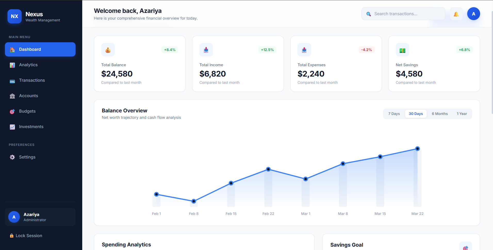
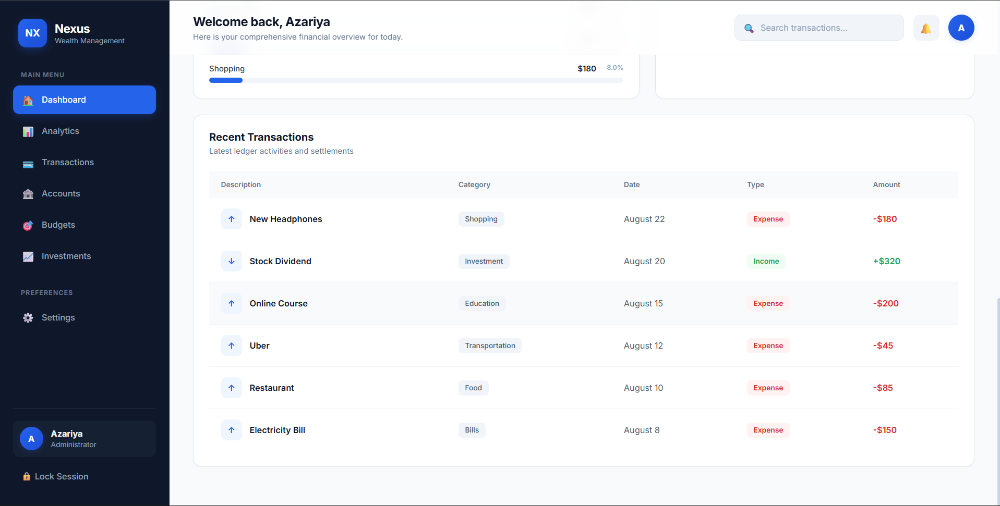

# Nexus Financial — Banking & Analytics Dashboard

A modern, responsive financial dashboard built with React that helps users manage transactions, monitor spending, track budgets, and visualize their financial activity through an interactive interface.

## 🚀 Live Demo

[View Live Demo](https://analytic-dashboard-opal.vercel.app/)

## ✨ Features

* **Dashboard Overview:** View key financial metrics and account summaries.
* **Transaction Management:** Track income and expenses with search and filtering.
* **Financial Analytics:** Visualize financial trends using interactive charts.
* **Budget Tracking:** Set spending limits and monitor category-based expenses.
* **Savings Goals:** Track progress toward personal financial goals.
* **Investment Tracking:** Monitor investment holdings and portfolio performance.
* **Dark Mode:** Switch between light and dark themes.
* **Profile Settings:** Update profile information through the settings panel.
* **Local Storage:** Save transactions, preferences, and other dashboard data in the browser.
* **Responsive Design:** Enjoy a clean interface across different screen sizes.

## 🛠️ Technologies Used

* React
* JavaScript (ES6+)
* HTML5
* CSS3
* React Hooks (`useState`, `useEffect`)
* Local Storage API
* SVG Charts
* Vercel

## 📸 Screenshots

### Dashboard Overview



### Transaction Management



## 💻 Getting Started

1. Clone the repository:

   ```bash
   git clone https://github.com/Azaariya/bank-analytics-dashboard.git
   ```

2. Navigate to the project folder:

   ```bash
   cd bank-analytics-dashboard
   ```

3. Open the project in your preferred code editor and follow the setup required by the project.

## 👨‍💻 Author

**Azaria**

Electrical and Computer Engineering Student | Aspiring Frontend Developer

* **GitHub:** [@Azaariya](https://github.com/Azaariya)
* **LinkedIn:** [Azariya Ameha](https://www.linkedin.com/in/azariya-ameha/)

## 📄 License

This project was created for learning and portfolio purposes.
